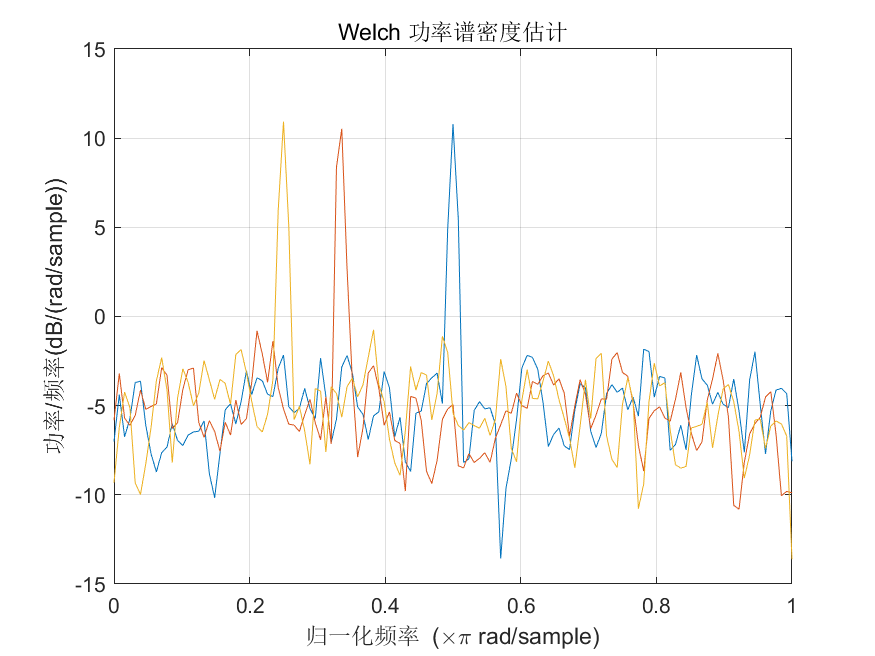
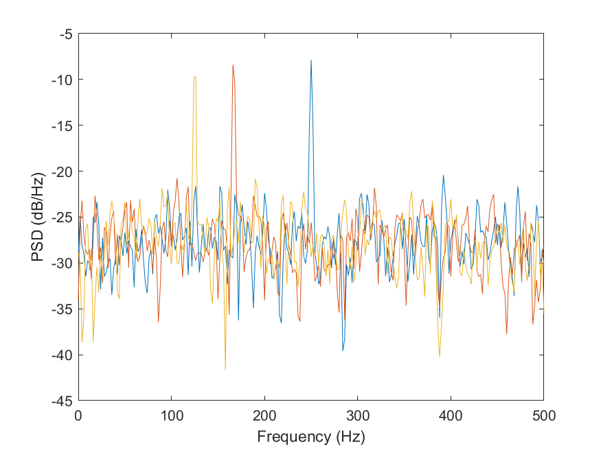

# MATLAB | Spectral Analysis Algorithm | Welch Power Spectrum Density Estimation | Include data and plotting code | Directly Useable

1. Basic Definition
The Welch Power Spectral Density Estimation is a spectral estimation method based on signal segment averaging, which can perform spectral analysis on time-domain signals and obtain the energy distribution of the signal at different frequencies. It has been widely applied in fields such as signal processing, communication, acoustics, etc. Compared to traditional spectral estimation methods, it offers better computational efficiency and estimation accuracy. The steps of Welch Power Spectral Density Estimation are as follows:
Given a time-domain signal x(n) with a length of N.
Divide the signal into L segments, each with M samples, with an overlap of M/2 between adjacent segments.
Perform preprocessing operations such as windowing and FFT on each segment to obtain its frequency domain representation.
Perform amplitude square operation on the frequency domain representation of each segment to obtain the power spectral density estimation value of each segment.
Perform averaging operation on the power spectral density estimation values of all segments to obtain the average power spectral density estimation value of the signal.
The advantage of Welch Power Spectral Density Estimation is its good computational efficiency and estimation accuracy. It also provides a good estimation effect for nonlinear components such as harmonics in the signal, and its estimation effect for higher order harmonics and other higher-order components is also good. However, this method requires segmented processing of the signal, so it may introduce estimation errors when the signal changes rapidly.
2. Definition and Outline Effects
The outline effects are as follows:
\n        \n          \n          \n          \n          \n            To view this video please enable JavaScript, and consider upgrading to a\n            web browser that\n            supports HTML5 video\n  

## Images

<!-- PAYMENT_BLOCK -->

## Get this dataset

- Payment link (Stripe): [Buy now](https://buy.stripe.com/3cs8yP7sY87d0vu9AB)
- Payment QR code: 

<!-- /PAYMENT_BLOCK -->
